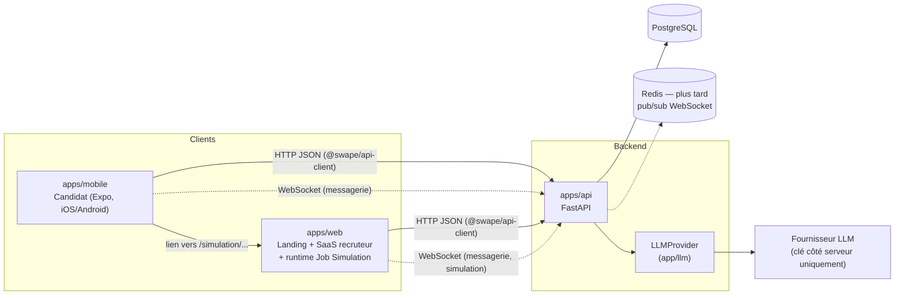

# Architecture de Swape

Source de vérité fonctionnelle : [`specs/cahier-des-charges.pdf`](specs/cahier-des-charges.pdf).
Décisions : [`adr/`](adr/). Vocabulaire : [`glossaire.md`](glossaire.md).

## Vue d'ensemble

## Monorepo

| Dossier | Rôle | Outils |
|---|---|---|
| `apps/api` | API REST + WebSocket, logique métier, autorisations, orchestration LLM | uv, FastAPI, SQLAlchemy 2 async, Alembic, pytest |
| `apps/web` | Landing publique (`/`), SaaS recruteur desktop (`/recruiter/*`), runtime candidat de la Job Simulation (`/simulation/*`) | pnpm, Vite, React, TanStack Query, Tailwind |
| `apps/mobile` | App candidat : profil, swipe, candidatures, chat | Expo, Expo Router |
| `packages/api-client` | Types TypeScript + client `openapi-fetch` générés depuis l'OpenAPI de l'API | openapi-typescript |
| `packages/design-tokens` | Charte « Modern Soft Tech » : couleurs, radius, polices, ombres (TS + CSS) | — |

## Backend : couches et domaines

`router → service → repository → models`, plus `schemas` (Pydantic). Un dossier par domaine dans `apps/api/app/` :
`auth`, `candidates`, `companies`, `offers`, `applications`, `messaging`, `subscriptions`, `simulation`, `llm`, `health`.
Les routers (`router.py`) et modèles (`models.py`) sont **découverts automatiquement** au démarrage (`app/discovery.py`) :
ajouter un domaine ne modifie aucun fichier partagé.

Erreurs : les services lèvent des `DomainError` (`app/core/errors.py`), converties en `{"error": {"code", "message"}}`.

## Contrat front ↔ back

L'OpenAPI de FastAPI est la seule définition du contrat. `make api-types` régénère `packages/api-client`,
la CI (job `api-types`) échoue si le fichier commité n'est pas à jour. Un Claude qui code le backend et un Claude
qui code le front restent ainsi alignés.

## Modèle de données

Le MCD est décrit dans [`mcd.md`](mcd.md) : entités, relations, règle freemium et suppression en cascade (RGPD).
Il est implémenté par le ticket « modèles + migration initiale ». Noms en anglais `snake_case` (voir le glossaire).

## Job Simulation

Trois blocs reliés par deux contrats (définis dans un ticket du Sprint 0) :

1. **Éditeur de scénarios** (recruteur, web) → produit un **scénario JSON versionné** (personnages, événements, branches, critères).
2. **Runtime** (candidat, route web `/simulation/*`) → interface multi-fenêtres (messagerie, mails, tâches, fichiers) en temps
   réel via WebSocket ; moteur d'événements côté API ; PNJ pilotés par LLM via `LLMProvider`. Produit un **journal d'événements**.
3. **Analyse et rapport** → lit le journal, produit un scoring **explicable critère par critère**, un feedback candidat,
   un rapport recruteur et des signaux de triche (indices, jamais sanction).

Règles AI Act (haut risque) : l'IA observe et résume, le recruteur décide ; pas de note opaque ; le candidat voit son rapport.

## Temps réel

WebSockets FastAPI pour la messagerie (débloquée au match) et la simulation. Tant qu'il n'y a qu'un worker API,
la diffusion se fait en mémoire ; Redis (pub/sub) est prévu dans `docker-compose.yml` pour le passage à plusieurs workers.

## Sécurité et RGPD

JWT access (15 min) + refresh (30 j), mots de passe Argon2, autorisation vérifiée sur chaque endpoint,
aucune donnée personnelle dans les logs, hébergement UE, données de démo fictives, scan de secrets (pre-commit + CI).
