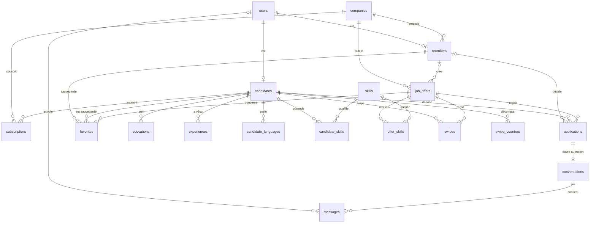

# MCD de Swape

Modèle de données de référence, implémenté par le ticket « modèles + migration initiale » (#22).
Source fonctionnelle : [`specs/cahier-des-charges.pdf`](specs/cahier-des-charges.pdf). Vocabulaire : [`glossaire.md`](glossaire.md).

**Hors périmètre :** les tables de la Job Simulation (epics #15 à #17), `notifications` (epic #11) et `consents` (epic #14).

## Conventions

- Tables et colonnes en anglais `snake_case`, tables au pluriel.
- Clé primaire `id` en `UUID`, sauf les tables d'association, à clé composite.
- `created_at` et `updated_at` en `timestamptz NOT NULL` sur chaque table. Ils ne sont pas répétés ci-dessous.
  Exceptions, car les lignes ne sont jamais modifiées : `skills`, `candidate_skills`, `offer_skills`, `swipes`,
  `favorites` et `messages` n'ont que `created_at` ; `swipe_counters` n'a que `updated_at`.
- Colonnes `NOT NULL` par défaut. `NULL` est indiqué explicitement dans la colonne Contraintes.
- Fichiers (CV, vidéo, logo) : la base stocke une clé de stockage (`*_key`), jamais le fichier.
- Colonne **Données perso** : `oui` pour une donnée personnelle directe, `sensible` pour une donnée à protéger en priorité
  (mot de passe, CV, vidéo), `indirecte` pour une donnée rattachée à une personne par une clé, `non` sinon.
- Le domaine indiqué sous chaque table est le dossier `apps/api/app/<domaine>/` qui porte le modèle.

## Diagramme

Un `users` correspond à exactement un `candidates` ou un `recruiters`, selon `role`. Le service d'inscription le garantit.

## Enums

| Enum PostgreSQL | Valeurs |
|---|---|
| `user_role` | `candidate`, `recruiter` |
| `contract_type` | `internship`, `apprenticeship`, `fixed_term`, `permanent`, `temporary`, `student_job` |
| `offer_status` | `active`, `filled`, `archived` |
| `salary_period` | `hour`, `month`, `year` |
| `education_level` | `no_degree`, `bac`, `bac_2`, `bac_3`, `bac_5`, `bac_8` |
| `language_level` | `a1`, `a2`, `b1`, `b2`, `c1`, `c2`, `native` |
| `swipe_direction` | `left`, `right` |
| `application_status` | `pending`, `matched`, `rejected` |
| `subscription_plan` | `candidate_premium`, `company_pro_monthly`, `company_pro_yearly` |
| `subscription_status` | `active`, `past_due`, `canceled`, `expired` |

## Entités

### Utilisateur — `users` (`auth`)

Compte de connexion, commun aux candidats et aux recruteurs.

| Attribut | Type | Clé | Contraintes | Données perso |
|---|---|---|---|---|
| `id` | `uuid` | PK | | indirecte |
| `email` | `varchar(254)` | | unique, stocké en minuscules | oui |
| `password_hash` | `varchar(255)` | | Argon2 | sensible |
| `role` | `user_role` | | | non |
| `is_active` | `boolean` | | défaut `true` | non |

### Candidat — `candidates` (`candidates`)

| Attribut | Type | Clé | Contraintes | Données perso |
|---|---|---|---|---|
| `id` | `uuid` | PK | | indirecte |
| `user_id` | `uuid` | FK `users` | unique, `ON DELETE CASCADE` | indirecte |
| `first_name` | `varchar(100)` | | | oui |
| `last_name` | `varchar(100)` | | | oui |
| `phone` | `varchar(20)` | | `NULL` | oui |
| `about` | `text` | | `NULL`, 2 000 caractères max | oui |
| `city` | `varchar(100)` | | `NULL` | oui |
| `education_level` | `education_level` | | `NULL` | oui |
| `available_from` | `date` | | `NULL` | oui |
| `cv_key` | `varchar(500)` | | `NULL` | sensible |
| `cover_letter` | `text` | | `NULL`, 5 000 caractères max ; lettre globale | oui |
| `intro_video_key` | `varchar(500)` | | `NULL` | sensible |
| `is_verified` | `boolean` | | défaut `false` | oui |

### Recruteur — `recruiters` (`companies`)

| Attribut | Type | Clé | Contraintes | Données perso |
|---|---|---|---|---|
| `id` | `uuid` | PK | | indirecte |
| `user_id` | `uuid` | FK `users` | unique, `ON DELETE CASCADE` | indirecte |
| `company_id` | `uuid` | FK `companies` | `ON DELETE RESTRICT` | indirecte |
| `first_name` | `varchar(100)` | | | oui |
| `last_name` | `varchar(100)` | | | oui |
| `job_title` | `varchar(150)` | | `NULL` | oui |

### Entreprise — `companies` (`companies`)

| Attribut | Type | Clé | Contraintes | Données perso |
|---|---|---|---|---|
| `id` | `uuid` | PK | | non |
| `name` | `varchar(200)` | | | non |
| `siret` | `char(14)` | | unique, `CHECK` 14 chiffres | non |
| `description` | `text` | | `NULL` | non |
| `website` | `varchar(500)` | | `NULL` | non |
| `city` | `varchar(100)` | | `NULL` | non |
| `logo_key` | `varchar(500)` | | `NULL` | non |

### Offre d'emploi — `job_offers` (`offers`)

| Attribut | Type | Clé | Contraintes | Données perso |
|---|---|---|---|---|
| `id` | `uuid` | PK | | non |
| `company_id` | `uuid` | FK `companies` | `ON DELETE CASCADE`, index | non |
| `created_by_recruiter_id` | `uuid` | FK `recruiters` | `NULL`, `ON DELETE SET NULL` | indirecte |
| `title` | `varchar(200)` | | | non |
| `description` | `text` | | | non |
| `contract_type` | `contract_type` | | | non |
| `status` | `offer_status` | | défaut `active`, index | non |
| `city` | `varchar(100)` | | | non |
| `duration_months` | `smallint` | | `NULL`, `CHECK > 0` ; `NULL` si sans durée (CDI) | non |
| `salary_min` | `integer` | | `NULL`, `CHECK >= 0`, euros bruts | non |
| `salary_max` | `integer` | | `NULL`, `CHECK >= salary_min` | non |
| `salary_period` | `salary_period` | | `NULL`, renseigné si un salaire l'est | non |

Une offre n'est pas supprimée par le recruteur : elle passe à `archived`. `salary_period` couvre les différences entre
gratification mensuelle (stage), taux horaire (job étudiant) et salaire annuel (CDI).

### Compétence — `skills` (`candidates`)

Référentiel partagé, sous forme de tags.

| Attribut | Type | Clé | Contraintes | Données perso |
|---|---|---|---|---|
| `id` | `uuid` | PK | | non |
| `name` | `varchar(80)` | | unique, stocké en minuscules | non |

### Compétence d'un candidat — `candidate_skills` (`candidates`)

| Attribut | Type | Clé | Contraintes | Données perso |
|---|---|---|---|---|
| `candidate_id` | `uuid` | PK, FK `candidates` | `ON DELETE CASCADE` | indirecte |
| `skill_id` | `uuid` | PK, FK `skills` | `ON DELETE RESTRICT` | indirecte |

### Compétence requise par une offre — `offer_skills` (`offers`)

| Attribut | Type | Clé | Contraintes | Données perso |
|---|---|---|---|---|
| `job_offer_id` | `uuid` | PK, FK `job_offers` | `ON DELETE CASCADE` | non |
| `skill_id` | `uuid` | PK, FK `skills` | `ON DELETE RESTRICT` | non |

### Formation — `educations` (`candidates`)

| Attribut | Type | Clé | Contraintes | Données perso |
|---|---|---|---|---|
| `id` | `uuid` | PK | | indirecte |
| `candidate_id` | `uuid` | FK `candidates` | `ON DELETE CASCADE`, index | indirecte |
| `school` | `varchar(200)` | | | oui |
| `degree` | `varchar(200)` | | | oui |
| `field_of_study` | `varchar(200)` | | `NULL` | oui |
| `start_date` | `date` | | | oui |
| `end_date` | `date` | | `NULL` si en cours, `CHECK >= start_date` | oui |

### Expérience — `experiences` (`candidates`)

| Attribut | Type | Clé | Contraintes | Données perso |
|---|---|---|---|---|
| `id` | `uuid` | PK | | indirecte |
| `candidate_id` | `uuid` | FK `candidates` | `ON DELETE CASCADE`, index | indirecte |
| `company_name` | `varchar(200)` | | | oui |
| `job_title` | `varchar(200)` | | | oui |
| `description` | `text` | | `NULL` | oui |
| `start_date` | `date` | | | oui |
| `end_date` | `date` | | `NULL` si en cours, `CHECK >= start_date` | oui |

### Langue d'un candidat — `candidate_languages` (`candidates`)

Ajoutée au ticket : les langues font partie des faits saillants (§5.2).

| Attribut | Type | Clé | Contraintes | Données perso |
|---|---|---|---|---|
| `id` | `uuid` | PK | | indirecte |
| `candidate_id` | `uuid` | FK `candidates` | `ON DELETE CASCADE` | indirecte |
| `language_code` | `char(2)` | | ISO 639-1 | oui |
| `level` | `language_level` | | | oui |

Contrainte : `UNIQUE (candidate_id, language_code)`.

### Swipe — `swipes` (`applications`)

Ajoutée au ticket : sans elle, une offre refusée réapparaîtrait dans le deck.

| Attribut | Type | Clé | Contraintes | Données perso |
|---|---|---|---|---|
| `id` | `uuid` | PK | | indirecte |
| `candidate_id` | `uuid` | FK `candidates` | `ON DELETE CASCADE` | indirecte |
| `job_offer_id` | `uuid` | FK `job_offers` | `ON DELETE CASCADE`, index | indirecte |
| `direction` | `swipe_direction` | | | indirecte |

Contrainte : `UNIQUE (candidate_id, job_offer_id)`. Une offre n'est donc swipée qu'une fois par candidat.

### Compteur de swipes — `swipe_counters` (`subscriptions`)

Voir [Règle freemium](#règle-freemium).

| Attribut | Type | Clé | Contraintes | Données perso |
|---|---|---|---|---|
| `candidate_id` | `uuid` | PK, FK `candidates` | `ON DELETE CASCADE` | indirecte |
| `swipe_date` | `date` | PK | jour civil, fuseau `Europe/Paris` | indirecte |
| `swipe_count` | `integer` | | défaut `0`, `CHECK >= 0` | indirecte |

### Candidature — `applications` (`applications`)

Créée dans la même transaction que le swipe à droite.

| Attribut | Type | Clé | Contraintes | Données perso |
|---|---|---|---|---|
| `id` | `uuid` | PK | | indirecte |
| `candidate_id` | `uuid` | FK `candidates` | `ON DELETE CASCADE` | indirecte |
| `job_offer_id` | `uuid` | FK `job_offers` | `ON DELETE CASCADE`, index | indirecte |
| `status` | `application_status` | | défaut `pending`, index | indirecte |
| `motivation` | `text` | | `NULL`, 2 000 caractères max ; « Pourquoi cette offre ? » | oui |
| `compatibility_score` | `smallint` | | `CHECK` entre 0 et 100 | indirecte |
| `matched_skills_count` | `smallint` | | `CHECK` entre 0 et `required_skills_count` | indirecte |
| `required_skills_count` | `smallint` | | `CHECK >= 0` | non |
| `decided_by_recruiter_id` | `uuid` | FK `recruiters` | `NULL`, `ON DELETE SET NULL` | indirecte |
| `decided_at` | `timestamptz` | | `NULL`, renseigné dès que `status` n'est plus `pending` (`CHECK`) | indirecte |

Contrainte : `UNIQUE (candidate_id, job_offer_id)`.

Le score est calculé à la création à partir des compétences (ex. « 4/6 compétences clés »), sans LLM, et conservé tel quel.
Seul un recruteur passe `status` à `matched` ou `rejected`.

### Conversation — `conversations` (`messaging`)

Créée au clic sur « Accepter le match ». Le candidat et l'entreprise se déduisent de la candidature.

| Attribut | Type | Clé | Contraintes | Données perso |
|---|---|---|---|---|
| `id` | `uuid` | PK | | indirecte |
| `application_id` | `uuid` | FK `applications` | unique, `ON DELETE CASCADE` | indirecte |

### Message — `messages` (`messaging`)

| Attribut | Type | Clé | Contraintes | Données perso |
|---|---|---|---|---|
| `id` | `uuid` | PK | | indirecte |
| `conversation_id` | `uuid` | FK `conversations` | `ON DELETE CASCADE` | indirecte |
| `sender_user_id` | `uuid` | FK `users` | `NULL`, `ON DELETE SET NULL` | indirecte |
| `body` | `text` | | entre 1 et 5 000 caractères (`CHECK`) | oui |
| `read_at` | `timestamptz` | | `NULL` | indirecte |

Index : `(conversation_id, created_at)`. `sender_user_id` à `NULL` signifie « ancien recruteur » : les messages d'un candidat
supprimé disparaissent avec sa candidature.

### Abonnement — `subscriptions` (`subscriptions`)

L'abonnement Pro appartient à l'entreprise, pas au recruteur.

| Attribut | Type | Clé | Contraintes | Données perso |
|---|---|---|---|---|
| `id` | `uuid` | PK | | indirecte |
| `candidate_id` | `uuid` | FK `candidates` | `NULL`, `ON DELETE CASCADE` | indirecte |
| `company_id` | `uuid` | FK `companies` | `NULL`, `ON DELETE CASCADE` | non |
| `plan` | `subscription_plan` | | | indirecte |
| `status` | `subscription_status` | | défaut `active` | indirecte |
| `started_at` | `timestamptz` | | | indirecte |
| `current_period_end` | `timestamptz` | | | indirecte |
| `canceled_at` | `timestamptz` | | `NULL` | indirecte |
| `provider_subscription_id` | `varchar(255)` | | `NULL`, unique ; identifiant chez le prestataire de paiement | indirecte |

Contraintes :

- `CHECK (num_nonnulls(candidate_id, company_id) = 1)` : un seul titulaire.
- `CHECK` de cohérence : `candidate_premium` si et seulement si `candidate_id` est renseigné.
- Index uniques partiels sur `candidate_id` et sur `company_id`, `WHERE status = 'active'` : un seul abonnement actif par titulaire.

Le Premium et le Pro se déduisent de cette table. La mise en avant du profil n'a donc pas de colonne dédiée.

### Favori — `favorites` (`companies`)

Un recruteur sauvegarde un candidat pour une offre donnée.

| Attribut | Type | Clé | Contraintes | Données perso |
|---|---|---|---|---|
| `id` | `uuid` | PK | | indirecte |
| `recruiter_id` | `uuid` | FK `recruiters` | `ON DELETE CASCADE` | indirecte |
| `candidate_id` | `uuid` | FK `candidates` | `ON DELETE CASCADE` | indirecte |
| `job_offer_id` | `uuid` | FK `job_offers` | `ON DELETE CASCADE` | indirecte |

Contrainte : `UNIQUE (recruiter_id, candidate_id, job_offer_id)`.

## Règle freemium

- **Comptage :** chaque swipe, à gauche comme à droite, incrémente la ligne `swipe_counters` du candidat pour le jour courant.
  La ligne est créée au premier swipe du jour, ce qui remet le compteur à zéro sans tâche planifiée.
- **Limite :** elle s'applique aux candidats sans abonnement `candidate_premium` actif. La valeur n'est pas en base mais dans
  la configuration de l'API, et son montant exact est défini dans l'epic #12.
- **Concurrence :** l'incrément se fait par un `INSERT ... ON CONFLICT DO UPDATE ... WHERE swipe_count < limite`. Si aucune ligne
  n'est touchée, la limite est atteinte et le swipe est refusé, sans dépassement possible.
- **Publicité :** pour un candidat gratuit, une publicité s'affiche quand `swipe_count` est un multiple de 10. Rien n'est stocké.
- **Pourquoi un compteur :** `swipes` permettrait de compter, mais `swipe_counters` lit le total du jour en une ligne et rend la
  limite atomique.

## RGPD

Les données personnelles sont identifiées dans la colonne **Données perso** de chaque table.

### Suppression en cascade

| Suppression | Effet en base | Effet côté service |
|---|---|---|
| Compte candidat (`users`) | supprime `candidates`, puis `educations`, `experiences`, `candidate_skills`, `candidate_languages`, `swipes`, `swipe_counters`, `applications`, `conversations`, `messages`, `favorites` et `subscriptions` du candidat | supprime aussi les fichiers `cv_key` et `intro_video_key` |
| Compte recruteur (`users`) | supprime `recruiters` et ses `favorites` ; met à `NULL` `job_offers.created_by_recruiter_id`, `applications.decided_by_recruiter_id` et `messages.sender_user_id` | offres, candidatures et conversations restent à l'entreprise |
| Entreprise (`companies`) | supprime `job_offers`, puis `offer_skills`, `swipes`, `applications`, `conversations`, `messages`, `favorites`, ainsi que les `subscriptions` | supprime d'abord les comptes de ses recruteurs (`ON DELETE RESTRICT` sinon), ainsi que `logo_key` |

Une cascade PostgreSQL ne supprime pas les fichiers du stockage objet : le service de suppression de compte doit le faire.

### Points traités par l'epic #14

Durées de conservation et purge, chiffrement des données sensibles, consentements, export, et conservation des justificatifs de
paiement (la suppression d'un compte efface sa ligne `subscriptions`).

## Couverture du cahier des charges

| Section | Besoin | Modélisation |
|---|---|---|
| §2 | Publicité, swipes illimités, Premium, Pro | `swipe_counters`, `subscriptions` |
| §4.1 | Profil, études, expériences, tags, CV, lettre, vidéo | `candidates`, `educations`, `experiences`, `candidate_skills` |
| §4.2 | Carte d'offre, swipe | `job_offers`, `companies`, `offer_skills`, `swipes` |
| §4.3 | Statut des candidatures, chat au match | `applications`, `conversations`, `messages` |
| §5.1 | Fiches de poste, archivage, suivi par offre | `job_offers`, décompte de `applications` par `status` |
| §5.2 | Score, filtres, vue détaillée, favoris | `applications`, `candidates`, `candidate_languages`, `favorites` |
| §5.3 | Accepter le match, salon de discussion | `applications.status`, `conversations` |
