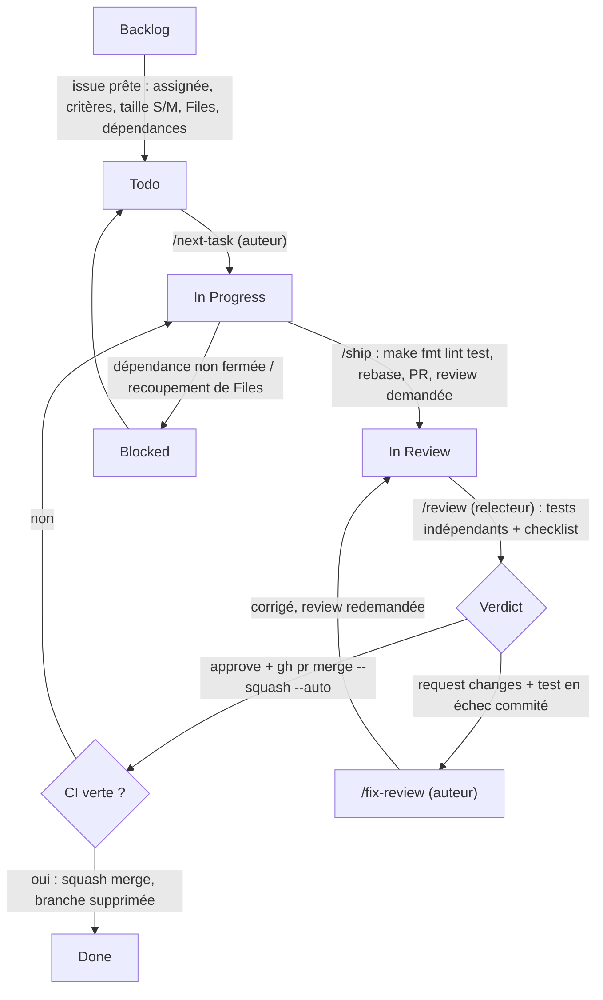

# Workflow : du ticket au merge

Tout vit dans GitHub (Issues + Project « Swape — Board ») pour que chaque Claude y accède avec `gh`.
Les commandes `/…` sont les skills de `.claude/skills/`.

## Schéma

## Étapes

| Étape | Qui | Commande | Statut |
|---|---|---|---|
| Découper le backlog en issues prêtes | équipe | templates d'issue | `Backlog` → `Todo` |
| Prendre une tâche | auteur | `/next-task [n]` | `Todo` → `In Progress` |
| Coder sur `<type>/<n>-<slug>` | auteur | `git fetch && git rebase origin/main` à chaque session | |
| Livrer | auteur | `/ship` | `In Progress` → `In Review` |
| Relire et tester | relecteur (rotation) | `/review [pr]` | |
| Corriger | auteur | `/fix-review [pr]` | reste `In Review` |
| Merger | auto-merge GitHub | — | `Done` (automatisation du Project) |
| Savoir quoi faire | chacun | `/info` | |
| Suivre | tous | `/board` | |

## Rotation de review

Hugo (`hugo-ry02`) relit Enzo (`enzorvg`), Enzo relit Louis (`louisbdt`), Louis relit Hugo.

## Règles qui rendent le parallèle possible

- **Issue prête** : un seul assigné, critères « Étant donné / Quand / Alors », zone, taille S ou M, « Bloquée par #N » pour
  chaque dépendance, champ `Files` rempli.
- **Exclusivité des fichiers** : deux tickets dont les `Files` se recoupent ne sont jamais `In Progress` en même temps
  (`scripts/board.sh conflicts <n>` le vérifie ; `/next-task` l'appelle).
- **Socle d'abord** : modèles, auth, thème, layout, client API, routers sont mergés avant les tickets fonctionnels parallèles.
- **Fichiers chauds** (liste dans `CLAUDE.md`) : on ajoute une ligne, on ne réorganise pas ; lockfiles et client généré
  sont régénérés, jamais fusionnés à la main ; une migration Alembic par ticket, créée juste avant `/ship`.

## Git

- Branche : `<type>/<n>-<slug>` (`feat`, `fix`, `chore`, `docs`, `test`, `refactor`).
- Commits : Conventional Commits en anglais avec le numéro : `feat(api): add swipe endpoint (#42)`.
- PR : même format de titre, `Closes #N`, template rempli. Merge **squash uniquement**, historique linéaire.
- Jamais de merge de `main` dans une branche : `git rebase origin/main`. Jamais de `--force`.
- `main` est protégée : PR obligatoire, 1 approbation, checks `api`, `web`, `mobile`, `api-types`, `secrets` verts,
  branche à jour, conversations résolues.
